# Capstone Assignment — Deploy the Book Review App Using Terraform and Claude Code Agentic AI

Part of the DevOps Micro Internship (DMI) Cohort 3 with Agentic AI

---

## Student Details

**Full Name:** Cho Kar Hin
**Cloud Platform:** AWS
**GitHub Repository URL:** `https://github.com/JokerHin/devops-micro-internship-pravinmishra`
**Public Application URL / Load-Balancer DNS:** Add the public URL or DNS here

---

## Purpose

Deploy the Book Review App using Terraform on AWS or Azure in a secure, highly available, production-style three-tier architecture. Use Claude Code, specialized subagents, Terraform MCP, and validation hooks to support the engineering workflow while keeping all infrastructure-changing operations under human control.

---

# Task 0 — Prepare the Project and Agentic AI Environment

## Goal

Prepare the Book Review App project and configure the provided Claude Code Agentic AI starter kit with project context, specialized subagents, Terraform MCP, validation hooks, and safety guardrails.

## Evidence

### Screenshot 1 — Project `CLAUDE.md`

Add a screenshot of the project `CLAUDE.md` showing the three-tier architecture, security boundaries, Terraform requirements, and human-approval rules.

---

### Screenshot 2 — Terraform Engineer Subagent

Add a screenshot showing the Terraform Engineer subagent configuration.

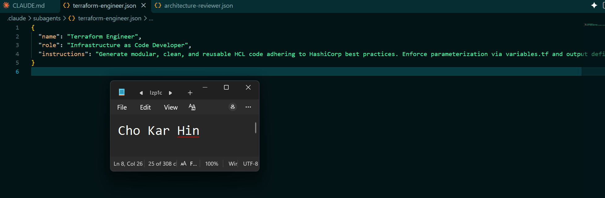

---

### Screenshot 3 — Architecture and Security Reviewer Subagent

Add a screenshot showing the Architecture and Security Reviewer subagent configuration.

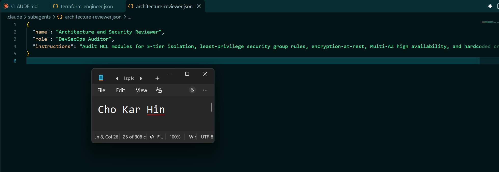

---

### Screenshot 4 — Terraform MCP Connection

Add a screenshot showing Terraform MCP connected and available.

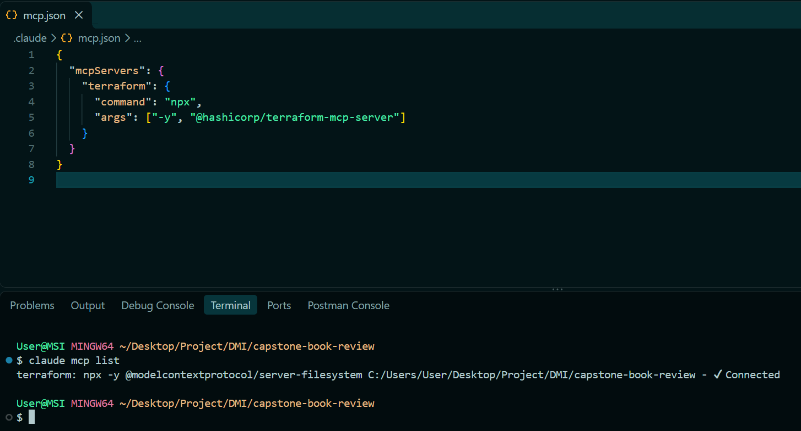

---

### Screenshot 5 — Validation Hooks

Add a screenshot showing the configured Claude Code validation hooks.

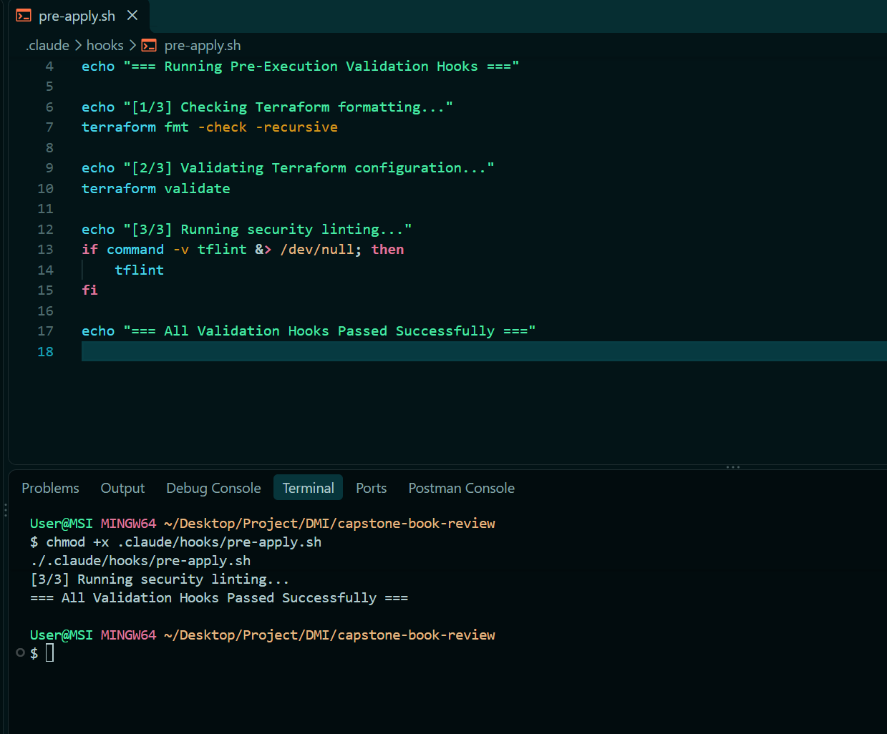

---

# Task 1 — Design the Three-Tier Architecture

## Goal

Design the required secure, highly available three-tier architecture and create an architecture diagram before building the infrastructure.

The diagram must show:

- VPC or VNet
- Availability Zones or equivalent availability locations
- Six subnets
- Internet connectivity
- NAT or outbound design
- Public load balancer
- Web Tier
- Internal load balancer
- Application Tier
- Managed MySQL
- Read replica
- Main traffic flow

## Architecture Diagram

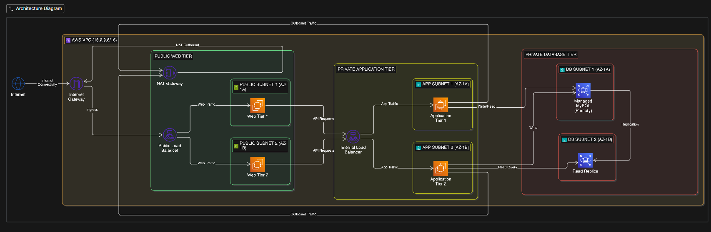

---

# Task 2 — Build the Terraform Networking and Security Layers

## Goal

Create the modular Terraform project and implement the network and security layers across the required public and private subnets.

## Evidence

### Screenshot 6 — Modular Terraform Project Structure

Add a screenshot showing the modular Terraform project structure.

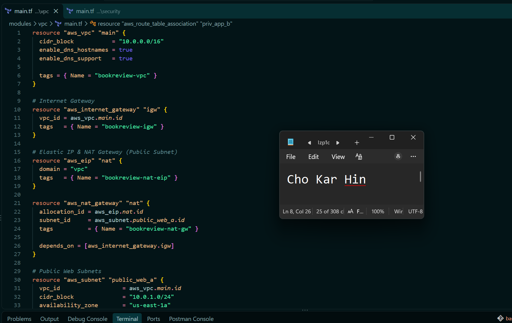

---

### Screenshot 7 — Six-Subnet Architecture

Add a screenshot showing the six-subnet architecture across two availability locations.

---

### Screenshot 8 — Public and Private Tier Separation

Add a screenshot showing the public and private tier separation, including routing and security boundaries.

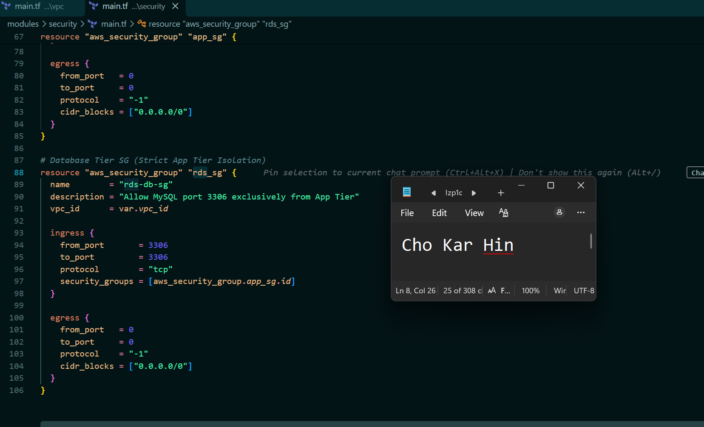

---

# Task 3 — Build the Load-Balancing and Compute Layers

## Goal

Deploy the public and internal load balancers and the Web and Application compute resources required by the Book Review App.

## Evidence

### Screenshot 9 — Web and Application Compute

Add a screenshot showing the Web and Application compute resources in their required subnets.

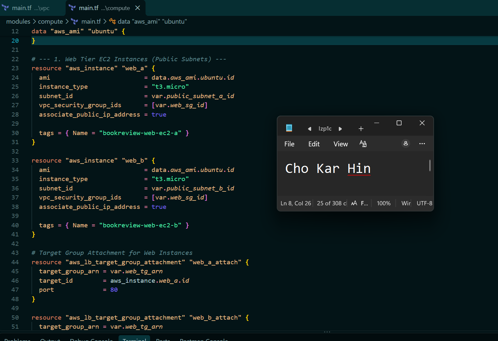

---

### Screenshot 10 — Public Load Balancer

Add a screenshot showing the internet-facing public load balancer.

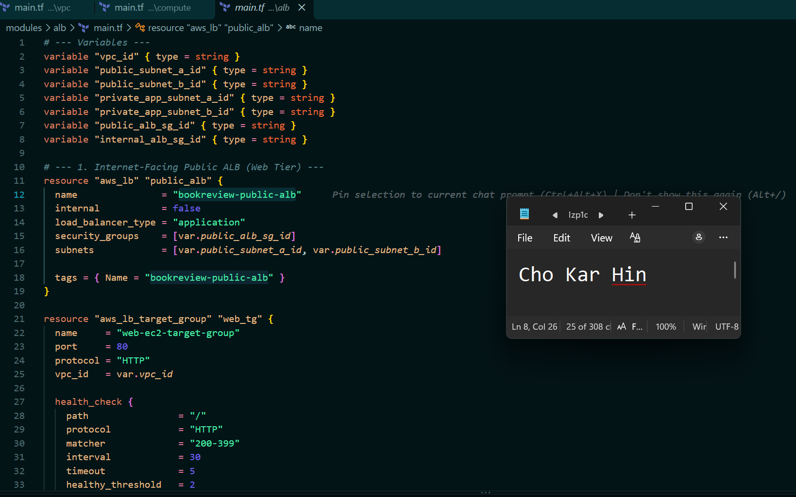

---

### Screenshot 11 — Internal Load Balancer

Add a screenshot showing the private internal load balancer.

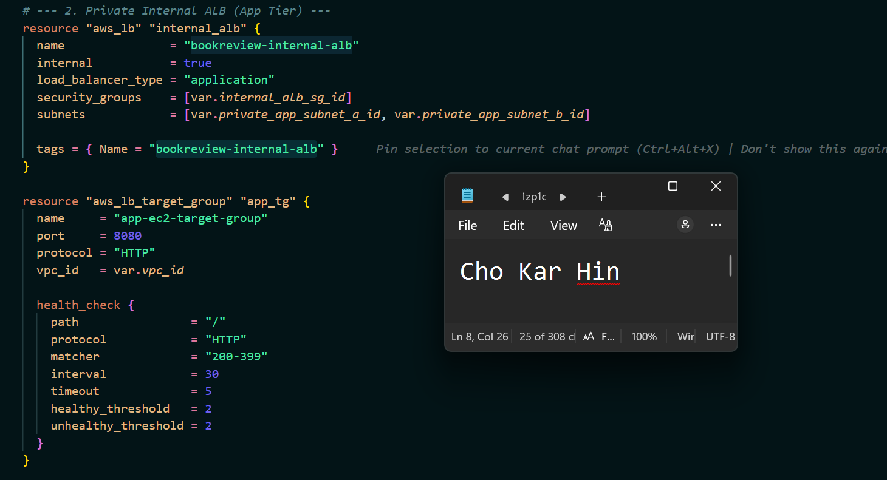

---

### Screenshot 12 — Healthy Targets

Add a screenshot showing healthy target groups or backend pools.

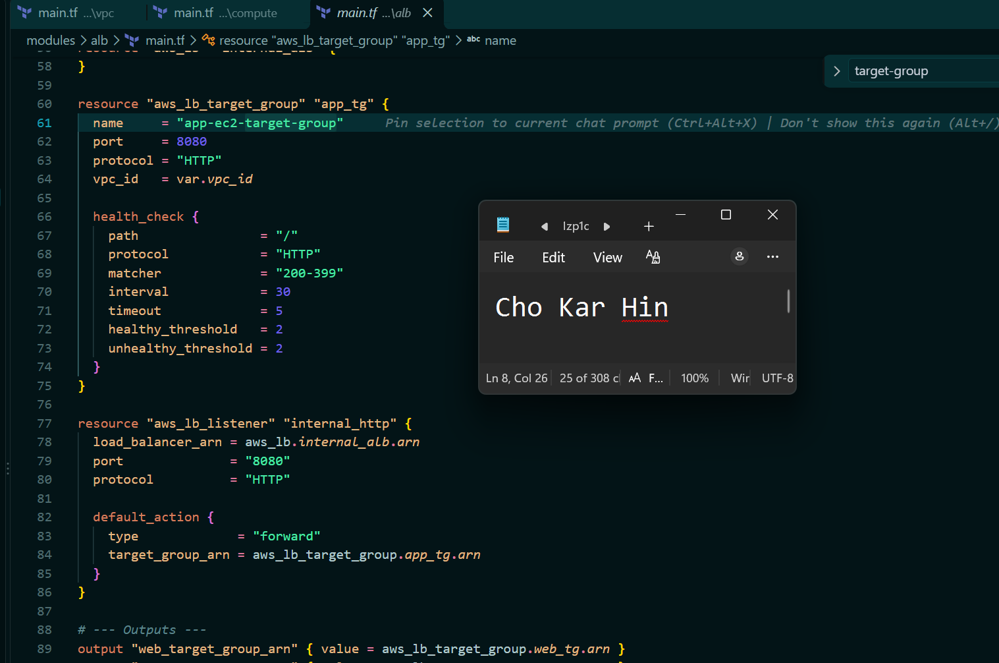

---

# Task 4 — Build the Managed MySQL Database Layer

## Goal

Deploy a private, highly available managed MySQL database with a read replica and restrict database connectivity to the Application Tier.

## Evidence

### Screenshot 13 — Managed MySQL Database

Add a screenshot showing the managed MySQL database deployment.

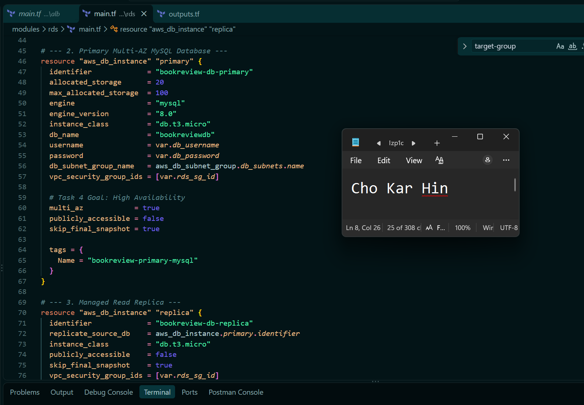

---

### Screenshot 14 — High Availability

Add a screenshot showing the Multi-AZ or high-availability configuration.

---

### Screenshot 15 — Read Replica

Add a screenshot showing the read replica configuration.

---

### Screenshot 16 — Private Database Access

Add a screenshot showing that the database is private and accepts MySQL traffic only from the Application Tier.

---

# Task 5 — Validate, Review, and Apply the Terraform Configuration

## Goal

Validate the Terraform configuration, review the execution plan using both Agentic AI and human judgment, and apply the infrastructure changes only after all required checks pass.

## Evidence

### Screenshot 17 — Terraform Validation

Add a screenshot showing successful `terraform validate` output.

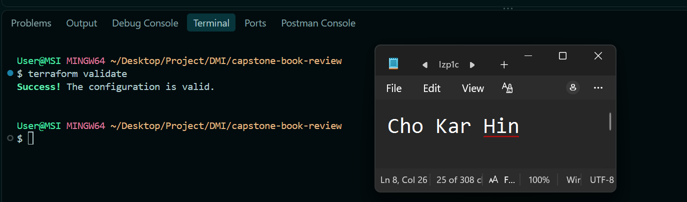

---

### Screenshot 18 — Terraform Plan

Add a screenshot showing the Terraform plan output.

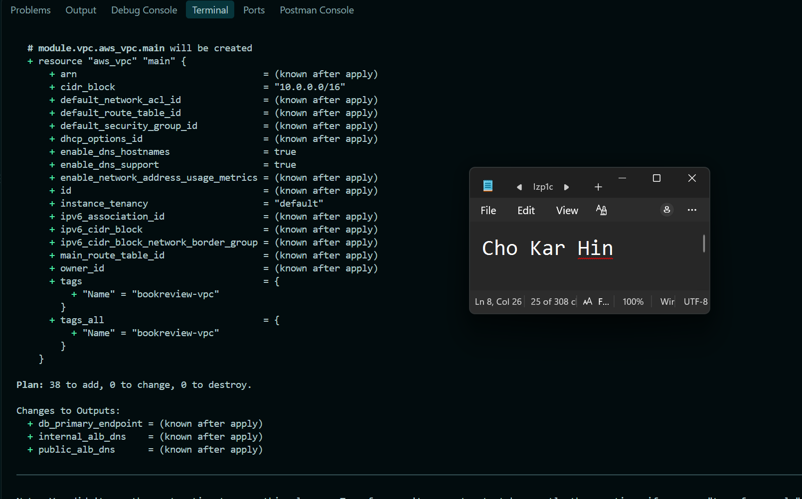

---

### Screenshot 19 — Terraform Apply

Add a screenshot showing successful `terraform apply` completion.

---

# Task 6 — Deploy and Configure the Book Review Application

## Goal

Deploy and configure the Book Review App across the Web, Application, and Database tiers and verify the complete application functionality.

## Evidence

### Screenshot 20 — Homepage

Add a screenshot showing the Book Review App homepage through the public endpoint.

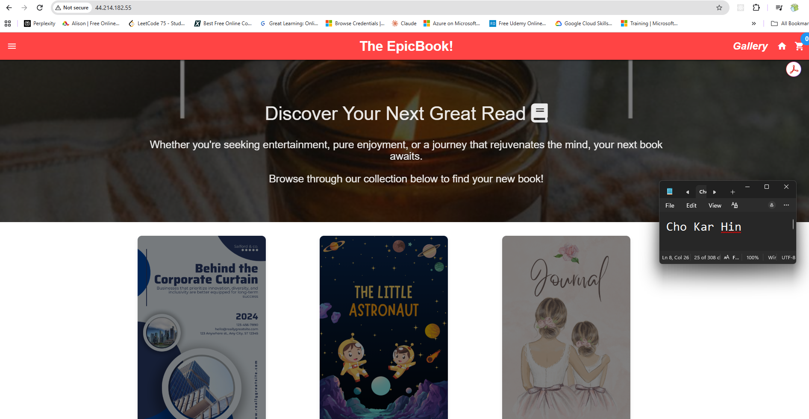

---

### Screenshot 21 — Login or Authentication

Add a screenshot showing successful login or authentication.

---

### Screenshot 22 — Book Data

Add a screenshot showing the book listing or book details.

---

### Screenshot 23 — Review Functionality

Add a screenshot showing the review functionality working successfully.

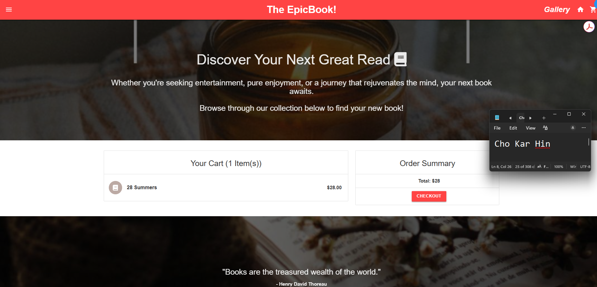

---

### Screenshot 24 — Backend or API Evidence

Add a screenshot showing that the backend or API is working successfully.

---

### Screenshot 25 — Database Reads and Writes

Add a screenshot showing successful database reads and writes.

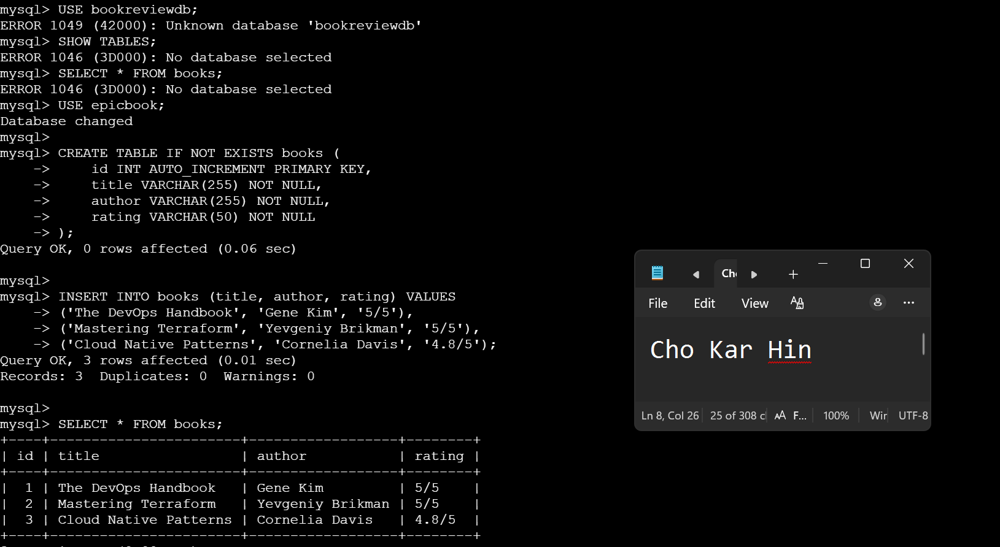

## Public Application URL

**Public Application URL / DNS:** `http://44.214.182.55/`

---

# Task 7 — Demonstrate the Agentic AI Workflow

## Goal

Demonstrate how Claude Code assisted with Terraform generation, architecture and security review, and evidence-based troubleshooting while infrastructure-changing decisions remained under human control.

You do not need to submit your complete Claude Code conversation history. Include only focused evidence.

## Evidence

### Screenshot 26 — AI-Assisted Terraform Generation

Add a screenshot showing one useful example of AI-assisted Terraform generation or improvement.

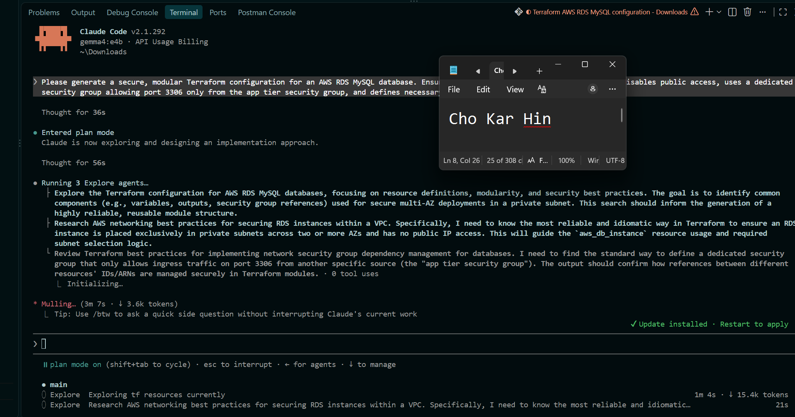

---

### Screenshot 27 — Architecture or Security Review

Add a screenshot showing one structured architecture or security review result.

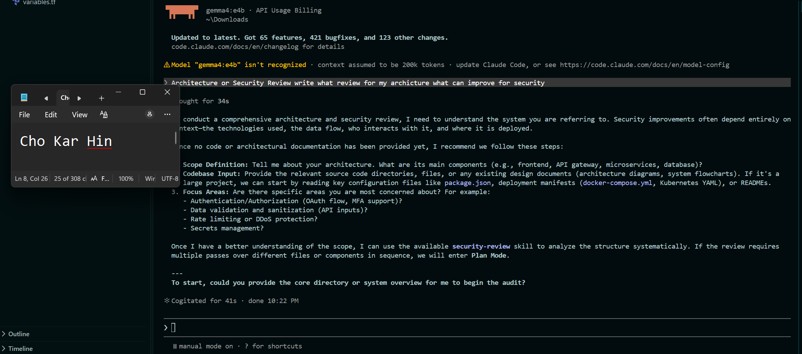

---

### Screenshot 28 — AI-Assisted Troubleshooting

Add a screenshot showing one AI-assisted troubleshooting interaction based on collected evidence.

---

# Task 8 — Complete the Final Architecture Review

## Goal

Review the completed infrastructure against the original capstone requirements and resolve significant architecture, security, reliability, and cost issues.

Confirm that the final review covers:

- Tier separation
- Availability
- Public exposure
- Routing
- Security rules
- Load balancing
- Database privacy
- Secrets
- Terraform quality
- Module structure
- Reliability
- Obvious cost risks

Use Screenshot 27 as the focused evidence for the structured architecture or security review.

---

# Task 9 — Answer the Reflection Questions

## Goal

Reflect on the architecture, Terraform implementation, and Agentic AI workflow. Answer each question briefly in your own words.

## Architecture

### 1. Why did you separate the Web, Application, and Database tiers?

Separating the Web, Application, and Database tiers follows the principle of defense-in-depth and modular scalability. Isolating components ensures that a breach in the public web layer does not directly compromise database assets, while allowing each tier to scale independently based on demand.

### 2. Why is the Application Tier private?

The Application Tier contains core business logic and database access parameters. Placing it in private subnets prevents direct exposure to public internet threats, ensuring traffic can only reach it after passing through the controlled Web Tier / Load Balancer.

### 3. Why is MySQL private?

MySQL stores sensitive transactional and user data. Placing it in private subnets with no public IP addresses prevents unauthorized external access, brute-force database attacks, and data exfiltration.

### 4. Why are multiple Availability Zones used?

Utilizing multiple Availability Zones provides high availability and fault tolerance. If an entire AWS data center facility experiences an outage, traffic automatically shifts or fails over to resources running in an alternate AZ, maintaining service uptime.

### 5. What is the difference between Multi-AZ/high availability and a read replica?

Multi-AZ provides synchronous replication and automated failover for disaster recovery (high availability), where the standby instance is inactive until a failure occurs. Read replicas use asynchronous replication to offload read-heavy database workloads from the primary DB instance, improving performance rather than providing automatic failover.

## Terraform

### 6. How did you divide your Terraform into modules?

The infrastructure was divided into functional modules:
vpc: Network foundation (VPC, public/private subnets, internet gateway, route tables).
security_groups: Firewall rules governing ingress/egress between web, app, and db layers.
ec2: Compute resources, user data initialization scripts, and web/app server provisioning.
rds: Amazon RDS MySQL instance, subnet groups, and database parameters.

### 7. How do the modules communicate through variables and outputs?

Modules pass data using Terraform outputs and input variables. For example, the vpc module outputs vpc_id and private_subnet_ids, which are passed as input variables into the security_groups and rds modules to dynamically link resources.

### 8. What did you specifically check in `terraform plan`?

During terraform plan, I verified:
The exact count of resources being created, updated, or destroyed (+ vs - actions).
Security group rules to ensure no accidental 0.000.0/0 exposure on internal ports like 3306 or 8080.
Resource naming conventions and correct subnet assignments across Availability Zones.

## Agentic AI

### 9. What was the purpose of `CLAUDE.md`?

CLAUDE.md served as the project context and instruction file for the AI agent. It defined repository standards, deployment constraints, database schemas, preferred CLI commands, and architectural boundaries to keep AI recommendations aligned with project requirements.

### 10. What work did the Terraform Engineer subagent perform?

The Terraform Engineer subagent generated modular HCL code, structured module input/output dependencies, refactored resource blocks, and prepared formatted configurations for deployment.

### 11. What did the Architecture and Security Reviewer identify?

The Architecture and Security Reviewer flagged potential security risks, such as hardcoded database credentials in default configuration files, unconstrained security group rules, and missing environment variables during initial process launches.

### 12. Why did you use Terraform MCP instead of relying only on Claude's existing Terraform knowledge?

Using the Terraform Model Context Protocol (MCP) allowed the AI agent to query real-time schema specifications, validate resource syntax against up-to-date provider documentation, and prevent hallucinated arguments in newer HCL provider versions.

### 13. What was the purpose of your validation hooks?

Validation hooks automatically enforced code quality and syntax compliance (e.g., executing terraform fmt -check and tflint) before changes were applied to the state, preventing execution errors early in the workflow.

### 14. Describe one real issue Claude helped you troubleshoot.

Claude helped diagnose and resolve an ECONNREFUSED 127.0.0.1:3306 database connection error. By inspecting PM2 logs and backend source code, Claude identified that Sequelize was falling back to 127.0.0.1 because config/config.json lacked explicit RDS endpoint properties and .env parameters were not loaded prior to ORM initialization.

### 15. Describe one recommendation you reviewed, modified, or rejected instead of accepting blindly.

When configuring database schema syncing, an automated AI recommendation suggested setting sequelize.sync({ force: true }) on app startup. I modified and rejected this in favor of explicit SQL seeding (author_seed.sql and books_seed.sql), because using force: true in production would drop and recreate existing database tables on every process restart, wiping critical user and book data.

---

# Task 10 — Publish the Mandatory LinkedIn Post

## Goal

Publish a LinkedIn post describing the capstone, the technical work completed, the Agentic AI workflow, and the lessons learned.

Write the post in your own words, include at least one project image or other proof, and ensure that it can be viewed by the submission reviewer.

## LinkedIn Post URL

**LinkedIn Post URL:** `https://www.linkedin.com/posts/kar-hin-cho_devops-dmi-devopsmicrointernship-ugcPost-7512882293045125120-usfO/ `

---

# Submission Instructions

- Complete Tasks 0–10 in sequence.
- Include all Screenshots 1–28 exactly as specified.
- Ensure that your full name is visible in the required screenshots.
- Include the selected cloud platform.
- Include the completed architecture diagram.
- Include the modular Terraform project structure.
- Include the working public application URL or public load-balancer DNS.
- Include all required Agentic AI workflow evidence.
- Answer all 15 reflection questions briefly in your own words.
- Include the published LinkedIn post URL.
- Do not expose cloud credentials, database passwords, SSH private keys, JWT secrets, access tokens, account IDs, Terraform state containing sensitive values, or other confidential information.
- Review all screenshots and project files carefully before submitting through GitHub.

---

# Completion Checklist

- [ ] Selected AWS or Azure
- [ ] Added and reviewed the Agentic AI starter files
- [ ] Configured `CLAUDE.md`
- [ ] Configured the Terraform Engineer subagent
- [ ] Configured the Architecture and Security Reviewer subagent
- [ ] Connected Terraform MCP
- [ ] Configured validation hooks and safety guardrails
- [ ] Created the architecture diagram
- [ ] Created the six-subnet design
- [ ] Configured public Web Tier routing
- [ ] Kept the Application Tier private
- [ ] Kept the Database Tier private
- [ ] Configured tier-specific Security Groups or NSGs
- [ ] Restricted backend port `3001`
- [ ] Restricted MySQL port `3306` to the Application Tier
- [ ] Created the public load balancer
- [ ] Created the internal load balancer
- [ ] Configured listeners and health checks
- [ ] Deployed the Web Tier compute resources
- [ ] Deployed the private Application Tier compute resources
- [ ] Provisioned private managed MySQL
- [ ] Configured Multi-AZ or high availability
- [ ] Configured a read replica
- [ ] Created the modular Terraform project
- [ ] Used variables, outputs, and module dependencies
- [ ] Used current Terraform documentation through MCP
- [ ] Used hooks for deterministic validation
- [ ] Completed `terraform fmt`
- [ ] Completed `terraform validate`
- [ ] Reviewed `terraform plan`
- [ ] Completed the Terraform Engineer review
- [ ] Completed the Architecture and Security review
- [ ] Applied the infrastructure only after human approval
- [ ] Deployed and configured the backend
- [ ] Deployed and configured the frontend
- [ ] Configured Nginx where required
- [ ] Configured the internal backend endpoint
- [ ] Configured the public frontend endpoint
- [ ] Verified the homepage
- [ ] Verified login or authentication
- [ ] Verified book data
- [ ] Verified review functionality
- [ ] Verified the backend API
- [ ] Verified database reads and writes
- [ ] Verified healthy load-balancer targets
- [ ] Included AI-assisted Terraform generation evidence
- [ ] Included one architecture or security review
- [ ] Included one AI-assisted troubleshooting example
- [ ] Completed the final architecture review
- [ ] Answered all 15 reflection questions
- [ ] Published the mandatory LinkedIn post
- [ ] Added the LinkedIn post URL
- [ ] Captured all 28 required screenshots
- [ ] Confirmed that my full name is visible in the required screenshots
- [ ] Checked that no secrets or sensitive information are exposed

---

## About DMI & CloudAdvisory

DevOps Micro Internship (DMI) is a project-based DevOps program run by Pravin Mishra (The CloudAdvisory), focused on real-world execution, systems thinking, and career readiness.

It helps learners build strong DevOps foundations through hands-on experience.

---

## Resources

- Book Review App Repository: [https://github.com/pravinmishraaws/book-review-app](https://github.com/pravinmishraaws/book-review-app)
- DMI Official Website: [https://dmi.pravinmishra.com](https://dmi.pravinmishra.com)
- University: [https://university.pravinmishra.com](https://university.pravinmishra.com)
- Discord Community: [https://discord.pravinmishra.com](https://discord.pravinmishra.com)
- Blog: [https://dmi.pravinmishra.com/blog](https://dmi.pravinmishra.com/blog)
- YouTube Playlist: [https://www.youtube.com/playlist?list=PLFeSNDtI4Cho](https://www.youtube.com/playlist?list=PLFeSNDtI4Cho)
- Pravin Mishra on LinkedIn: [https://www.linkedin.com/in/pravin-mishra-aws-trainer/](https://www.linkedin.com/in/pravin-mishra-aws-trainer/)
- CloudAdvisory on LinkedIn: [https://www.linkedin.com/company/thecloudadvisory/](https://www.linkedin.com/company/thecloudadvisory/)

---

_This submission is part of the DevOps Micro Internship (DMI) Cohort 3 — Agentic AI Track._
