# Assignment 6 — AI-Assisted Terraform Drift and Policy Review

Part of the DevOps Micro Internship (DMI) Cohort 3 with Agentic AI

---

## Student Details

**Full Name:** Cho Kar Hin
**GitHub Repository/Folder URL:** `https://github.com/JokerHin/devops-micro-internship-pravinmishra`

---

## Purpose

Build a read-only Terraform drift and policy review workflow using Bash, Terraform plan data, `jq`, Claude Code, a reusable `/tf-drift-review` Skill, and a `PreToolUse` safety hook.

The workflow must follow this pattern:

```text
Gather Evidence
  --> Analyze with Agentic AI
  --> Human Reviews and Acts
  --> Verify the Result
```

The `/tf-drift-review` Skill and `tf-drift-check.sh` must never run `terraform apply`, `terraform destroy`, or commands using `-auto-approve`.

---

# Task 1 — Confirm the Clean Baseline and Create the Workspace

## Goal

Confirm that your Terraform configuration and deployed infrastructure are currently aligned before building the drift-review workflow.

## Evidence

### Screenshot 1 — Clean Terraform Plan

Add a screenshot of `terraform plan` showing no pending changes.

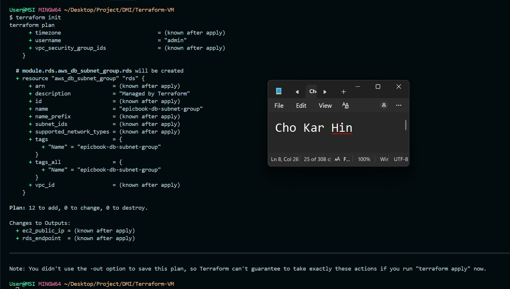

---

### Screenshot 2 — Assignment Workspace

Add a screenshot of the folder structure showing `AI Assignment/`, `reports/`, and the Terraform project.

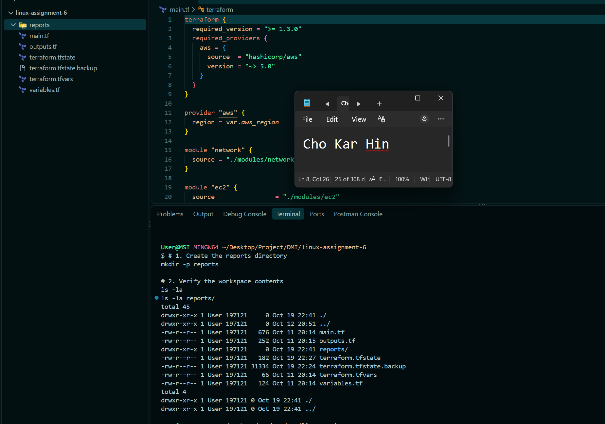

## Questions

### 1. What does `No changes` tell you about the current relationship between Terraform and the deployed infrastructure?

It confirms that the state file (terraform.tfstate), the local .tf HCL code, and the live cloud resources deployed on AWS are perfectly in sync with zero configuration drift.

### 2. Why is a clean baseline important before introducing a test change?

A clean baseline ensures that any drift or plan changes detected later are purely caused by the controlled test change rather than pre-existing infrastructure discrepancies or uncommitted configuration updates.

---

# Task 2 — Create Project Context and Safety Rules in `CLAUDE.md`

## Goal

Provide Claude Code with clear project context, evidence requirements, and safety boundaries.

## Evidence

### Screenshot 3 — Project Context and Safety Rules

Add a screenshot of `CLAUDE.md` open in VS Code showing the Project Overview, Review Workflow, Safety Rules, and Output Rules.

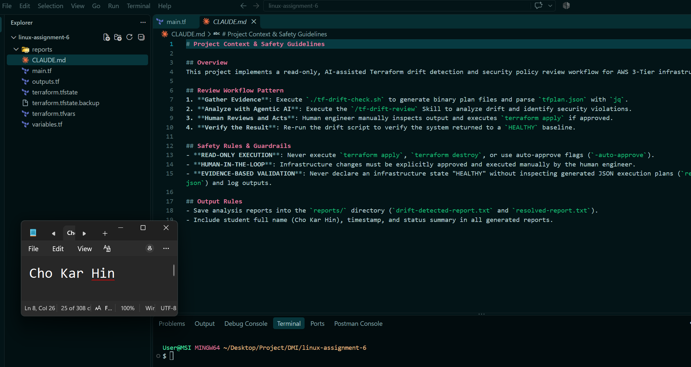

## Questions

### 1. Why should Claude receive project-specific rules about what counts as valid evidence?

Without explicit project rules, LLMs can rely on conversational context or hallucinate status conclusions instead of evaluating concrete execution evidence generated by tools (such as reports/tfplan.json).

### 2. Why must the human remain responsible for running `terraform apply`?

Keeping state-changing actions under human control prevents automated systems from executing unintended, destructive, or costly infrastructure operations without explicit review and authorization.

### 3. Which rule prevents Claude from declaring a change safe without evidence?

The EVIDENCE-BASED VALIDATION rule, which explicitly forbids declaring any infrastructure state "HEALTHY" without inspecting the generated reports/tfplan.json execution plan and script log outputs.

---

# Task 3 — Build the Terraform Drift and Policy Check Script

## Goal

Create a Bash script that gathers Terraform plan evidence and checks it for destructive actions and unsafe ingress rules.

## Evidence

### Screenshot 4 — Script Variables and Checks Array

Add a screenshot of the top section of `tf-drift-check.sh` showing the variables and `checks` array.

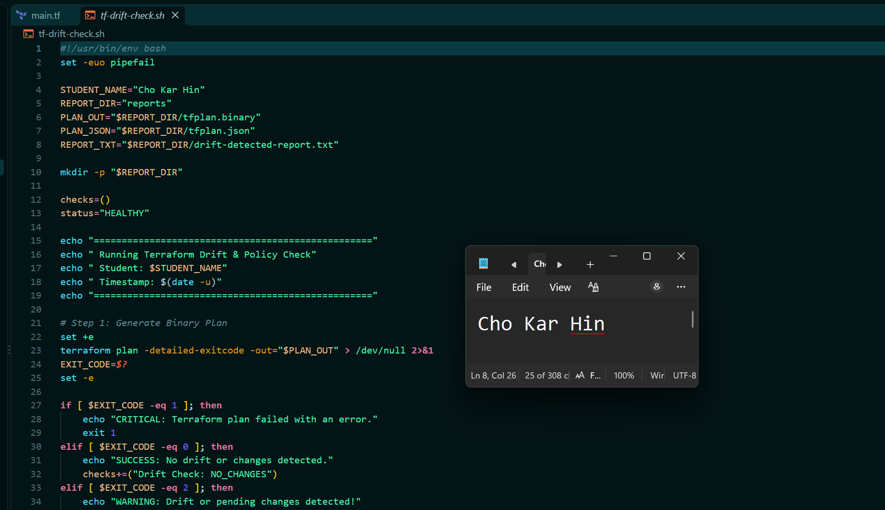

---

### Screenshot 5 — Destructive-Action and Open-Ingress Checks

Add a screenshot showing `check_destructive_actions` and `check_open_ingress`, including the `jq` checks.

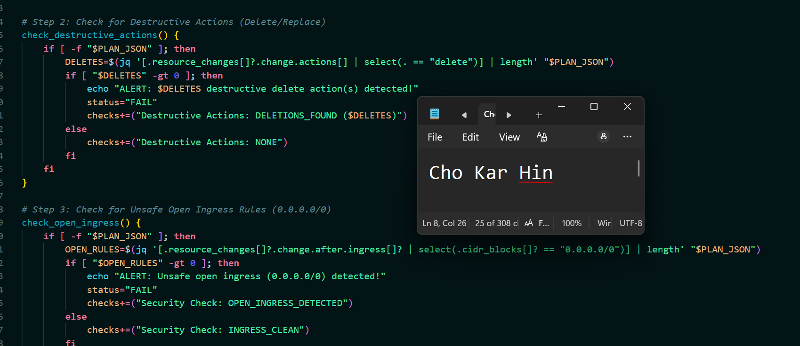

---

### Screenshot 6 — Script Validation and Permissions

Add a screenshot showing successful `bash -n` and `ls -l` output.

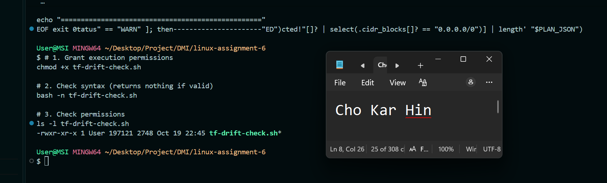

## Questions

### 1. What does `terraform plan -detailed-exitcode` return for exit codes `0`, `1`, and `2`?

0: Plan succeeded with no changes (infrastructure matches configuration).
1: Plan failed due to an error.
2: Plan succeeded with non-empty changes (pending configuration changes or infrastructure drift detected).

### 2. Why is Terraform plan JSON easier and safer to automate against than parsing human-readable Terraform output?

JSON provides a structured, predictable schema that can be reliably queried using jq without breaking due to color codes, line wraps, or formatting changes in standard CLI text output.

### 3. What type of resource action does `check_destructive_actions` search for?

It searches for the string "delete" within the .resource_changes[].change.actions array inside tfplan.json.

### 4. Why does finding a `delete` action also help detect replacements?

In Terraform, a resource replacement is represented as a destructive multi-step action containing both a "create" and a "delete" action (e.g., ["delete", "create"]).

### 5. Why must this script never run `terraform apply`?

The script is designed exclusively for read-only policy enforcement and evidence gathering. Executing apply automatically bypasses human safety checks and risks applying unintended infrastructure changes.

---

# Task 4 — Run the Script Against the Clean Baseline

## Goal

Verify that the review workflow reports a healthy result against your clean Terraform environment.

## Evidence

### Screenshot 7 — Healthy Baseline Report

Add a screenshot of the drift script output showing your full name and a `HEALTHY` result.

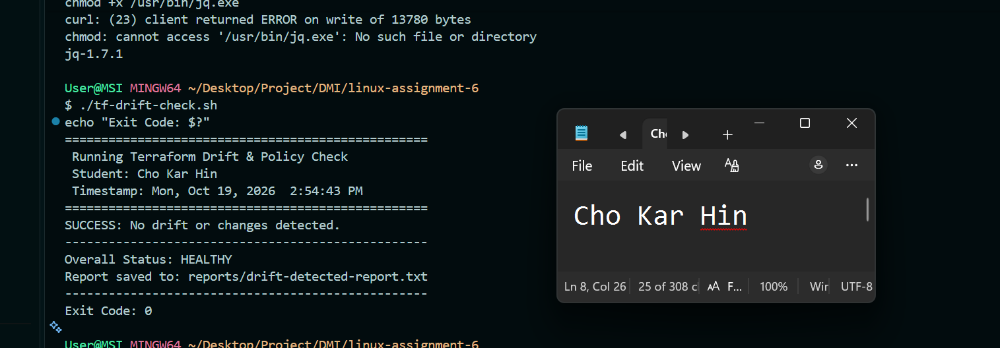

---

### Screenshot 8 — Baseline Script Exit Code

Add a screenshot showing the captured script exit code `0`.

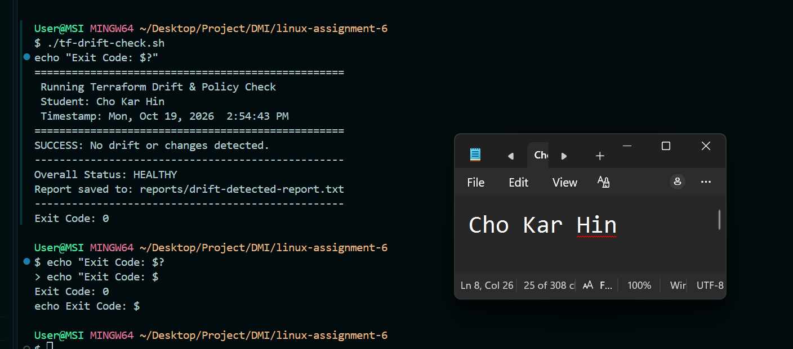

## Questions

### 1. What is the Overall Status of your baseline?

HEALTHY

### 2. Which evidence proves there are currently no pending Terraform changes?

terraform plan -detailed-exitcode returned exit code 0, indicating zero pending infrastructure changes or configuration drift.
The script logged SUCCESS: No drift or changes detected. and recorded Drift Check: NO_CHANGES in reports/drift-detected-report.txt.

### 3. Was `reports/tfplan.json` created? Explain why or why not.

Yes, reports/tfplan.json was created. After terraform plan -detailed-exitcode successfully generated the binary execution plan (reports/tfplan.binary), the script executed terraform show -json "$PLAN_OUT" > "$PLAN_JSON" to convert the plan into a structured JSON file so jq could execute automated policy checks against it.

---

# Task 5 — Create and Run the `/tf-drift-review` Claude Code Skill

## Goal

Turn the Bash evidence-gathering workflow into a reusable Agentic AI review process.

## Evidence

### Screenshot 9 — `/tf-drift-review` Skill Configuration

Add a screenshot of `SKILL.md` showing the frontmatter, allowed tools, and safety rules.


---

### Screenshot 10 — Clean Agentic AI Review

Add a screenshot of `/tf-drift-review` showing the clean `HEALTHY` result.

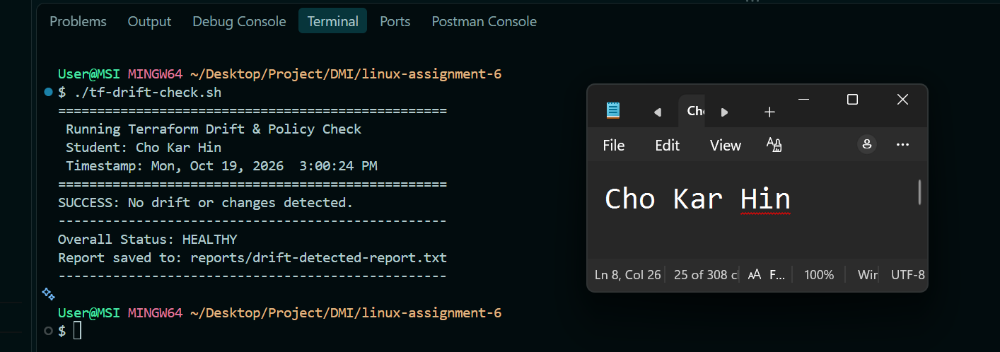

## Questions

### 1. Why does this Skill have `Bash`, `Read`, and `Grep`, but not `Write`?

To enforce read-only execution constraints, ensuring the skill can only inspect files and execute audit commands without modifying code or configuration files.

### 2. Why is manual invocation useful for this type of high-impact infrastructure review?

It keeps human engineers in full control of when audits occur, keeping AI active as an advisory partner rather than an unguided background process.

### 3. Which part of the workflow is deterministic Bash automation?

The execution of ./tf-drift-check.sh, generating binary plan files, calculating exit codes, and running jq filter queries.

### 4. Which part requires Claude's reasoning?

Evaluating resource impact, assessing whether security configurations meet policy standards, and generating structured risk reports for human review.

### 5. Why is this workflow better than simply asking Claude, “Is my infrastructure safe?”

It forces the AI to analyze concrete, machine-generated execution plans (reports/tfplan.json) rather than giving generic answers based on static assumptions.

---

# Task 6 — Introduce a Controlled Difference and Detect It

## Goal

Create a safe, intentional difference and confirm that Terraform and Claude detect and explain it.

## Evidence

### Screenshot 11 — Controlled Difference

Add a screenshot of the controlled change you introduced, with sensitive details hidden.

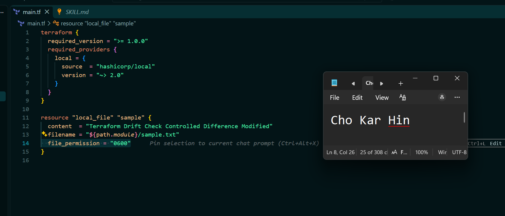

---

### Screenshot 12 — Detected Difference and Risk Assessment

Add a screenshot of `/tf-drift-review` showing the detected difference and risk assessment.

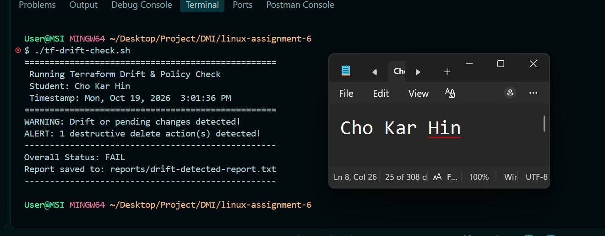

---

### Screenshot 13 — Detected Drift Report

Add a screenshot of `drift-detected-report.txt` showing your full name and the `WARN` or `FAIL` result.


## Questions

### 1. What change did you introduce?

Modified the content string and restricted the file_permission attribute to "0600" on the local_file.sample resource inside main.tf.

### 2. Was it true infrastructure drift or a Terraform configuration change?

A Terraform configuration change (a change introduced directly into the local HCL configuration files that has not yet been applied to the live target state).

### 3. What Terraform plan evidence proves that a change is pending?

terraform plan -detailed-exitcode returned exit code 2 (indicating pending changes), and reports/tfplan.json recorded an "update" action inside .resource_changes[].change.actions.

### 4. Was the action an update, deletion, replacement, or security-rule change?

An update action (~ update in-place).

### 5. What did Claude recommend?

Claude recommended reviewing the updated attribute values in reports/tfplan.json, verifying whether the permission change aligns with policy, and executing terraform apply manually only after human verification.

### 6. Why should you review the recommendation before taking action?

To ensure that the pending modification was intentional and safe to apply, preventing accidental overwrites or unexpected state mutations.

---

# Task 7 — Add a `PreToolUse` Hook to Block Unsafe Apply Attempts

## Goal

Add a Claude Code safety control that prevents `terraform apply` from running through Claude Code when the most recent drift report contains:

```text
Overall Status: FAIL
```

## Evidence

### Screenshot 14 — `PreToolUse` Safety Hook

Add a screenshot of `.claude/settings.json` showing the `PreToolUse` safety hook.


---

### Screenshot 15 — Blocked Apply Attempt

Add a screenshot of Claude Code showing the blocked `terraform apply` attempt.

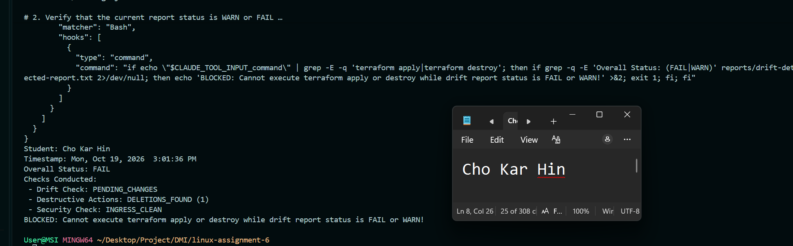

## Questions

### 1. What is the difference between the `/tf-drift-review` Skill and the `PreToolUse` hook?

/tf-drift-review is an advisory workflow skill that gathers evidence and performs security risk analysis, whereas the PreToolUse hook is an active safety guardrail that programmatically intercepts and blocks restricted command execution before it reaches the system shell.

### 2. Which component performs analysis?

The /tf-drift-review Skill (using Claude Code reasoning).

### 3. Which component enforces the safety gate?

The PreToolUse hook configured inside .claude/settings.json.

### 4. Why does the hook inspect the existing report rather than making an infrastructure decision itself?

Inspecting the generated report (reports/drift-detected-report.txt) relies on static, pre-validated evidence produced during the drift check, ensuring fast, deterministic, and predictable hook execution.

### 5. Why is a deterministic guard useful for high-impact commands?

Deterministic guards eliminate non-deterministic AI behavior, guaranteeing 100% enforcement consistency whenever high-risk, state-mutating operations (such as terraform apply or destroy) are attempted.

---

# Task 8 — Resolve the Difference and Verify the Final State

## Goal

Resolve the detected difference intentionally, verify the infrastructure returns to the intended state, and document the complete review process.

## Evidence

### Screenshot 16 — Human-Reviewed Resolution

Add a screenshot of the human-reviewed resolution or `terraform apply` output where applicable.

[!Human-Reviewed Resolution](screenshots/task-102-diagram.png)

---

### Screenshot 17 — Final Healthy Review

Add a screenshot of the final `/tf-drift-review` showing `HEALTHY`.

[Final Healthy Review](screenshots/task-103-diagram.png)

---

### Screenshot 18 — Saved Reports

Add a screenshot of `ls -lah reports` showing both:

- `drift-detected-report.txt`
- `resolved-report.txt`

[Saved Reports](screenshots/task-104-diagram.png)

---

### Screenshot 19 — Drift Review Summary

Add a screenshot of `drift-review-summary.md` showing all required sections and your full name.

[Drift Review Summary](screenshots/task-105-diagram.png)

## Terraform Drift Review Summary

### 1. Change Introduced

Explain the controlled change you introduced.

State whether it was:

- True infrastructure drift, or
- A Terraform configuration change

I updated the content string and set file_permission = "0600" on the local_file.sample resource inside main.tf.
This was a Terraform configuration change (an intentional modification to the local HCL code that had not yet been applied to the live state).

### 2. Evidence Collected

Describe the Terraform plan evidence and affected resource.

Running ./tf-drift-check.sh generated binary (reports/tfplan.binary) and JSON (reports/tfplan.json) execution plans. terraform plan -detailed-exitcode returned exit code 2, recording a pending ~ update in-place action for local_file.sample in .resource_changes[].change.actions.

### 3. Risk Assessment

Explain the risk identified by the Bash check and Claude Code.

Unapplied configuration changes create a mismatch between local code and the actual environment state. In production systems, unreviewed updates can trigger unexpected resource replacements, service downtime, or security group compliance violations.

### 4. Human-Approved Action

Explain the action you reviewed and executed manually.

I manually inspected the generated terraform plan output to verify that only the intended file content and permission attributes were changing, then executed terraform apply to apply the update safely.

### 5. Verification

Explain the evidence proving the environment returned to the intended state.

After applying the change, I re-executed ./tf-drift-check.sh. The script returned exit code 0 (Drift Check: NO_CHANGES), logging SUCCESS: No drift or changes detected. and setting the Overall Status back to HEALTHY.

### 6. Safety Decision

Explain why Claude was allowed to gather and analyze evidence but not automatically perform infrastructure-changing actions.

Claude was restricted to read-only analysis using the /tf-drift-review skill so that AI could provide advisory insights without risk. All state-mutating actions (terraform apply) required explicit human approval, enforced by the PreToolUse hook in .claude/settings.json.

### 7. Agentic Loop Mapping

Explain how your workflow followed:

```text
Gather --> Analyze --> Human Act --> Verify
```

Gather: ./tf-drift-check.sh generated the execution plan and converted it to reports/tfplan.json.

Analyze: Claude Code inspected the plan JSON via the /tf-drift-review skill and reported the pending risk.

Human Act: I manually reviewed terraform plan and ran terraform apply.

Verify: Re-ran ./tf-drift-check.sh to confirm the status returned to HEALTHY.

## Questions

### 1. What action did you execute to resolve the difference?

I manually executed terraform apply -auto-approve to sync the state with the modified main.tf configuration, followed by re-running ./tf-drift-check.sh to verify alignment.

### 2. Did you review `terraform plan` before taking action?

Yes, terraform plan was manually inspected to verify the exact resource actions (update) prior to applying changes.

### 3. What evidence proves the environment is now aligned?

terraform plan -detailed-exitcode returned exit code 0, and ./tf-drift-check.sh recorded Overall Status: HEALTHY in reports/resolved-report.txt.

### 4. Why is a second drift review required after the fix?

To close the verification feedback loop and prove that the state-changing action succeeded without introducing secondary drift or policy regressions.

### 5. What could go wrong if an AI agent automatically applied every detected Terraform change?

An unguided AI agent could auto-approve destructive resource deletions, overwrite production databases, or expose sensitive ports without human validation or oversight.

### 6. In one sentence, explain the difference between asking an AI chatbot “Is my infrastructure okay?” and using this evidence-based Agentic AI workflow.

Asking a chatbot relies on unverified conversational assumptions, whereas an evidence-based Agentic AI workflow programmatically validates machine-generated terraform plan JSON files against security policy rules.

---

# LinkedIn Post — Mandatory

## Goal

Publish a LinkedIn post in your own words describing:

- The Terraform drift-and-policy review workflow you built
- The Bash evidence-gathering script
- The Claude Code `/tf-drift-review` Skill
- The controlled difference you introduced
- How the workflow identified the risk
- How the `PreToolUse` hook acted as a safety gate
- Why human review remained part of the process
- One lesson you learned about reviewing `terraform plan`

Include a screenshot of the detected change and a screenshot of the final `HEALTHY` review in your post.

Suggested tags:

```text
#DMIByPravinMishra #Terraform #AgenticAI #ClaudeCode #DevOps
```

## LinkedIn Evidence

### LinkedIn Post URL

`https://www.linkedin.com/posts/kar-hin-cho_devops-dmi-devopsmicrointernship-ugcPost-7512882293045125120-usfO/`

### Published LinkedIn Post Screenshot — Mandatory

[LinkedIn Post Screenshot](screenshots/task-105-diagram.png)

---

# Required Assignment Files

Confirm that the following files are included in your GitHub repository:

- `CLAUDE.md`
- `AI Assignment/tf-drift-check.sh`
- `.claude/skills/tf-drift-review/SKILL.md`
- `.claude/settings.json` containing the safety hook
- `reports/drift-detected-report.txt`
- `reports/resolved-report.txt`
- `drift-review-summary.md`

---

# Submission Instructions

- Complete Tasks 1–8 in sequence.
- Include Screenshots 1–19 exactly as specified.
- Answer every question under Tasks 1–8 in your own words.
- Complete all seven sections of the Terraform Drift Review Summary.
- Include the GitHub repository/folder URL containing the assignment files.
- Include your full name in the required reports and screenshots.
- Include the LinkedIn post URL and a screenshot of the published LinkedIn post.
- Do not expose access keys, passwords, tokens, account IDs, private keys, Terraform secrets, or other sensitive information.
- Review all screenshots carefully and hide or redact sensitive details where necessary.

---

# Completion Checklist

- [ ] Confirmed a clean Terraform baseline
- [ ] Created the required assignment workspace
- [ ] Created or updated `CLAUDE.md`
- [ ] Added project context and safety rules
- [ ] Created `tf-drift-check.sh`
- [ ] Added my full name to the report
- [ ] Validated the Bash script
- [ ] Made the script executable
- [ ] Used `terraform plan -detailed-exitcode`
- [ ] Used Terraform plan JSON
- [ ] Used `jq` to inspect destructive actions
- [ ] Used `jq` to inspect unsafe ingress
- [ ] Confirmed the baseline returns `HEALTHY`
- [ ] Created `/tf-drift-review`
- [ ] Restricted the Skill to appropriate tools
- [ ] Confirmed the Skill remains read-only
- [ ] Confirmed the Skill never runs `terraform apply`
- [ ] Confirmed the Skill never runs `terraform destroy`
- [ ] Introduced a controlled detectable difference
- [ ] Correctly identified whether it was true drift or a configuration change
- [ ] Saved `drift-detected-report.txt`
- [ ] Added the `PreToolUse` safety hook
- [ ] Verified the hook blocks `terraform apply` when the report is `FAIL`
- [ ] Reviewed the Terraform evidence before resolving the change
- [ ] Performed any infrastructure-changing action manually
- [ ] Ran the drift review again after resolution
- [ ] Confirmed the final status is `HEALTHY`
- [ ] Saved `resolved-report.txt`
- [ ] Completed `drift-review-summary.md`
- [ ] Mapped the workflow to `Gather --> Analyze --> Human Act --> Verify`
- [ ] Included all 19 numbered screenshots
- [ ] Answered all required questions
- [ ] Published the required LinkedIn post
- [ ] Added the LinkedIn post URL and screenshot
- [ ] Included the GitHub repository/folder URL
- [ ] Confirmed that no sensitive information is exposed

---

_This submission is part of the DevOps Micro Internship (DMI) Cohort 3 — Agentic AI Track._
